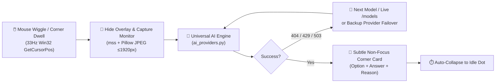

# 🧠 Quiz Cracker

[](https://github.com/abdulrehman244-ai/Quiz-cracker)
[](https://www.python.org/)
[-2ea043)](requirements.txt)
[](#-supported-ai-providers)
[](test_quiz_cracker.py)

A lightweight, **mouse-move-only** Windows desktop overlay that captures and solves on-screen multiple-choice questions (MCQs) using **any major Vision AI provider** — with **no clicking, no keyboard shortcuts, and no window switching**.

Simply **wiggle your mouse left-and-right** (or up-and-down), and Quiz Cracker silently captures the active monitor, queries your configured Vision AI model, and displays a compact, translucent answer card in the corner of your screen without ever stealing window focus.

---

## 📑 Table of Contents

- [Key Features](#-key-features)
- [Supported AI Providers](#-supported-ai-providers)
- [How It Works](#-how-it-works)
- [Installation](#-installation)
- [Ways to Launch](#-ways-to-launch)
- [First-Time Setup & Configuration](#-first-time-setup--configuration)
- [Using Local Models (Ollama / LM Studio)](#-using-local-models-ollama--lm-studio)
- [Usage & Controls](#-usage--controls)
- [Building a Standalone `.exe`](#-building-a-standalone-exe)
- [Project Structure](#-project-structure)
- [Running Tests](#-running-tests)
- [Troubleshooting](#-troubleshooting)
- [Privacy, Security & Disclaimer](#-privacy-security--disclaimer)

---

## ✨ Key Features

### 🖱️ Zero-Click Mouse Gesture Triggers
- **Mouse Wiggle / Shake Detection**: Rapid horizontal (left-right) or vertical (up-down) direction reversals trigger a screen capture automatically. Normal cursor movement never causes false triggers.
- **Optional Top-Right Corner Dwell**: Hold the cursor in the top-right corner of the active monitor for `0.65s` to trigger a scan.
- **Smart Cooldown**: Built-in cooldown prevents accidental double-triggers right after a scan completes.
- **Manual Region Capture (`🎯`)**: Optionally drag a crosshair box over any specific part of your screen (even across multi-monitor setups) when you want to isolate a single question.

### 🌐 Universal Vision AI Engine (Zero Extra SDKs)
- Built purely on Python's standard library (`urllib.request`, `json`, `base64`) — **no bloated AI SDKs** to install or break.
- **13+ AI Providers Out of the Box**: Works with Google Gemini, Groq, OpenRouter, OpenAI, Anthropic Claude, Mistral AI, xAI Grok, NVIDIA NIM, Together AI, Fireworks AI, SambaNova Cloud, Hugging Face Router, and any Custom/Local OpenAI-compatible server (Ollama, LM Studio, Azure, etc.).
- **Automatic Provider Detection**: Paste any API key and Quiz Cracker automatically identifies the provider by key prefix (or probes ambiguous keys during testing), strips accidental whitespace/quotes/`Bearer ` prefixes, and loads matching vision models.
- **Live Model Discovery**: Clicking **`🔍 Test & Detect`** queries the provider's `/models` endpoint in real time, filters for vision-capable models, and selects a verified working model on your account.
- **Automatic Model Fallback**: If a model returns HTTP `400`, `404`, `429` (rate limit), or `503`, Quiz Cracker automatically tries the next vision model and falls back to live `/models` discovery.
- **Multi-Provider Failover**: Keys are stored per provider. If you save keys for 2 or more providers (for example, Gemini + Groq + OpenRouter), Quiz Cracker automatically fails over to your backup provider if the primary one hits quota limits or errors.
- **Cloudflare-Safe Requests**: Sends a standard desktop `User-Agent` header so providers behind Cloudflare (Groq, OpenRouter, Mistral, xAI) don't reject requests with HTTP `403`.
- **Resilient JSON Parsing**: Handles raw JSON, markdown-fenced JSON blocks, embedded JSON objects, and plain-text fallbacks cleanly.

### 🪟 Native Subtle Windows Overlay
- **Non-Focus-Stealing (`WS_EX_NOACTIVATE`)**: Popping up the scanning badge or answer card never steals focus from your browser, document, or active window.
- **Hidden from Taskbar & Alt+Tab (`WS_EX_TOOLWINDOW`)**: Keeps your taskbar and window switcher clutter-free.
- **Windows 11 Rounded Corners**: Uses `DwmSetWindowAttribute` (`DWMWA_WINDOW_CORNER_PREFERENCE`) for crisp native rounded corners (graceful no-op on Windows 10).
- **Per-Monitor DPI Awareness**: Sharp rendering across `100%`–`200%` Windows display scaling, and automatically captures whichever monitor your cursor is currently on.
- **Low-Glare Translucent UI**:
  - **Idle state**: Tiny low-opacity corner dot (`34%` opacity) or small muted pill.
  - **Scanning state**: Compact translucent `Solving...` indicator.
  - **Answer card**: Soft-contrast corner badge displaying the option letter/choice, short exact answer, and ultra-brief reasoning, with configurable auto-hide (`6s`, `10s`, `15s`, or never).
- **Answer History & Clipboard Copy**: Stores the last 10 solved answers in memory (displays the 5 most recent in the expandable history drawer) and supports one-click copy (`📋`).
- **Single-Instance Guard**: Uses a Windows named mutex and wakeup event (`Local\QuizCrackerOverlaySingleInstance_v2`). Launching the app a second time opens the Settings window of the running instance instead of spawning duplicates.

---

## 🌐 Supported AI Providers

Paste **any** API key into Settings — Quiz Cracker detects the provider automatically.

| Provider | Key Prefix | Free Tier | Protocol | Default Vision Models | Get API Key |
|---|---|---|---|---|---|
| **Google Gemini** | `AIza...` | ✅ Yes | Gemini REST | `gemini-2.5-flash`, `gemini-2.5-flash-lite`, `gemini-2.0-flash`, `gemini-2.0-flash-lite`, `gemini-flash-latest`, `gemini-1.5-flash` | [Google AI Studio](https://aistudio.google.com/apikey) |
| **Groq** | `gsk_...` | ✅ Yes (Fast) | OpenAI-compat | `meta-llama/llama-4-scout-17b-16e-instruct`, `meta-llama/llama-4-maverick-17b-128e-instruct`, `llama-3.2-11b-vision-preview`, `llama-3.2-90b-vision-preview` | [Groq Console](https://console.groq.com/keys) |
| **OpenRouter** | `sk-or-...` | ✅ Yes (`:free`) | OpenAI-compat | `google/gemini-2.0-flash-exp:free`, `meta-llama/llama-4-scout:free`, `qwen/qwen2.5-vl-72b-instruct:free`, `google/gemini-2.5-flash`, `openai/gpt-4o-mini` | [OpenRouter Keys](https://openrouter.ai/keys) |
| **OpenAI (ChatGPT)** | `sk-...`, `sk-proj-...`, `sk-svcacct-...` | Paid | OpenAI-compat | `gpt-4o-mini`, `gpt-4.1-mini`, `gpt-4o`, `gpt-4.1` | [OpenAI Platform](https://platform.openai.com/api-keys) |
| **Anthropic Claude** | `sk-ant-...` | Paid | Anthropic Messages | `claude-3-5-haiku-latest`, `claude-sonnet-4-20250514`, `claude-3-5-sonnet-latest`, `claude-3-haiku-20240307` | [Anthropic Console](https://console.anthropic.com/settings/keys) |
| **Mistral AI** | Any (auto-probed) | ✅ Yes | OpenAI-compat | `pixtral-12b-2409`, `mistral-small-latest`, `pixtral-large-latest` | [Mistral Console](https://console.mistral.ai/api-keys/) |
| **xAI (Grok)** | `xai-...` | Paid | OpenAI-compat | `grok-2-vision-latest`, `grok-2-vision-1212`, `grok-vision-beta` | [xAI Console](https://console.x.ai/) |
| **NVIDIA NIM** | `nvapi-...` | ✅ Yes | OpenAI-compat | `meta/llama-3.2-11b-vision-instruct`, `meta/llama-3.2-90b-vision-instruct`, `microsoft/phi-3.5-vision-instruct` | [NVIDIA Build](https://build.nvidia.com/) |
| **Together AI** | `tgp_v1_...` | ✅ Yes | OpenAI-compat | `meta-llama/Llama-Vision-Free`, `meta-llama/Llama-3.2-11B-Vision-Instruct-Turbo`, `Qwen/Qwen2.5-VL-72B-Instruct` | [Together Settings](https://api.together.xyz/settings/api-keys) |
| **Fireworks AI** | `fw_...` | Paid | OpenAI-compat | `accounts/fireworks/models/llama-v3p2-11b-vision-instruct`, `accounts/fireworks/models/qwen2p5-vl-32b-instruct` | [Fireworks Account](https://fireworks.ai/account/api-keys) |
| **SambaNova Cloud** | Any (auto-probed) | ✅ Yes | OpenAI-compat | `Llama-4-Maverick-17B-128E-Instruct`, `Llama-3.2-11B-Vision-Instruct`, `Llama-3.2-90B-Vision-Instruct` | [SambaNova Cloud](https://cloud.sambanova.ai/apis) |
| **Hugging Face Router** | `hf_...` | ✅ Yes | OpenAI-compat | `Qwen/Qwen2.5-VL-7B-Instruct`, `meta-llama/Llama-3.2-11B-Vision-Instruct` | [HF Tokens](https://huggingface.co/settings/tokens) |
| **Custom / Local** | Optional | ✅ Free (Local) | OpenAI-compat | `llava`, `qwen2.5vl`, `gemma3`, `llama3.2-vision` (default URL: `http://localhost:11434/v1`) | [Ollama](https://ollama.com/) |

---

## ⚙️ How It Works



1. **Gesture Polling (`33 Hz`)**: `QuizCrackerApp` polls `user32.GetCursorPos` every `30ms` and passes coordinates to `MouseGestureWatcher` — no global mouse/keyboard hooks required.
2. **Clean Screen Capture**: When triggered, the overlay briefly withdraws (`70ms`), captures the monitor containing the cursor via `mss`, gently downscales displays wider than `1920px` with Lanczos resampling, and encodes a compact JPEG (`quality=88`).
3. **Background AI Solve**: A background daemon thread sends the base64-encoded screenshot to the active provider (`ai_providers.solve_mcq_with_provider`) with structured JSON instructions, automatic model fallback, live `/models` discovery, and backup provider failover.
4. **Subtle Display**: The overlay smoothly reappears in your chosen screen corner with the answer badge, text, and brief reason, logs the answer into session history, and auto-collapses back to a subtle idle dot after your configured timeout.

---

## 🚀 Installation

### Prerequisites
- **OS**: Windows 10 or Windows 11
- **Python**: Python 3.9 or higher (with `tkinter`, included in the standard Windows Python installer)

### Step-by-Step Setup

1. **Clone the repository**:
   ```bash
   git clone https://github.com/abdulrehman244-ai/Quiz-cracker.git
   cd Quiz-cracker
   ```

2. **Install dependencies** (only `mss` and `Pillow` are required):
   ```bash
   pip install -r requirements.txt
   ```

3. *(Optional)* **Regenerate the app icon** (`assets/quiz_cracker.ico` is already included):
   ```bash
   python create_assets.py
   ```

4. *(Optional)* **Create a Windows Desktop Shortcut** (`Quiz Cracker.lnk` pointing to `pythonw.exe` with the custom icon):
   ```powershell
   powershell -ExecutionPolicy Bypass -File .\create_desktop_shortcut.ps1
   ```

---

## ▶️ Ways to Launch

Choose whichever launch method fits your workflow:

| Method | Command / File | Console Window? |
|---|---|---|
| **Desktop Shortcut** | Double-click `Quiz Cracker` on Desktop (created via `create_desktop_shortcut.ps1`) | No (silent) |
| **Windowless Python** | Double-click `Quiz Cracker.pyw` | No (silent) |
| **VBScript Launcher** | Double-click `Launch Quiz Cracker.vbs` | No (silent) |
| **Terminal / CLI** | `python quiz_cracker.py` | Yes |
| **Standalone EXE** | `dist\Quiz Cracker.exe` (built via `build_exe.bat`) | No (silent) |

> **Tip:** If Quiz Cracker is already running in the corner, launching it again will automatically bring up its **Settings** window instead of opening a second copy.

---

## 🛠️ First-Time Setup & Configuration

On first launch (when no API key is saved yet), the **Universal AI Setup & Settings** window opens automatically:

1. **Paste Any API Key** into the key field (or use **`📋 Paste`** / right-click → Paste).
   - Need a free key? Pick a free-tier provider such as **Google Gemini**, **Groq**, or **OpenRouter**, and click **`🌐 Get API Key`** to open its signup page.
2. **Auto-Detection**: As soon as you paste a recognized key (`AIza...`, `gsk_...`, `sk-or-...`, `sk-...`, `sk-ant-...`, `xai-...`, `nvapi-...`, `hf_...`, `fw_...`, `tgp_v1_...`), Quiz Cracker switches the provider and populates its vision models automatically.
3. **Click `🔍 Test & Detect`**: Verifies your key, queries the provider's live `/models` list, and selects a working vision model automatically.
4. *(Optional)* **Add Backup Keys for Automatic Failover**: Switch the Provider dropdown to a second provider (e.g., Groq or OpenRouter), paste its key, test it, and save. Keys are remembered per provider in `provider_keys` so Quiz Cracker can fail over seamlessly if one provider hits a rate limit.
5. **Click `💾 Save & Close`**.

### Configuration File (`~/.quiz_cracker_config.json`)

All settings and API keys are stored locally in your Windows user profile directory at:
`C:\Users\<YourUsername>\.quiz_cracker_config.json`

| Key | Default | Description |
|---|---|---|
| `provider` | `"auto"` | Active provider ID (`"auto"`, `"gemini"`, `"groq"`, `"openrouter"`, `"openai"`, `"anthropic"`, `"mistral"`, `"xai"`, `"nvidia"`, `"together"`, `"fireworks"`, `"sambanova"`, `"huggingface"`, `"custom"`) |
| `api_key` | `""` | Active provider API key |
| `provider_keys` | `{}` | Map of `{provider_id: api_key}` used for per-provider memory and automatic backup failover |
| `model` | `""` | Preferred model ID (blank = automatic default & live fallback) |
| `custom_base_url` | `"http://localhost:11434/v1"` | Endpoint URL when `provider` is `"custom"` |
| `wiggle_enabled` | `true` | Enable mouse wiggle/shake trigger |
| `corner_trigger_enabled` | `false` | Enable top-right corner dwell trigger (`0.65s`) |
| `sensitivity` | `"medium"` | Wiggle sensitivity (`"high"`, `"medium"`, `"low"`) |
| `corner` | `"bottom-right"` | Overlay anchor corner (`"bottom-right"`, `"bottom-left"`, `"top-right"`, `"top-left"`) |
| `auto_collapse_sec` | `10` | Seconds before answer card collapses to idle (`6`, `10`, `15`, or `0` for never) |
| `popup_opacity` | `0.65` | Answer popup opacity (`0.45`, `0.65`, `0.78`, `0.90`) |
| `idle_style` | `"dot"` | Idle indicator appearance (`"dot"` for tiny dot, `"pill"` for muted `● Wiggle` pill) |

---

## 💻 Using Local Models (Ollama / LM Studio)

Run Quiz Cracker **100% locally and offline** with no API keys required:

1. Install [Ollama](https://ollama.com/) and pull a vision-capable model:
   ```bash
   ollama pull qwen2.5vl
   # or: ollama pull llava / ollama pull llama3.2-vision / ollama pull gemma3
   ```
2. Open Quiz Cracker **Settings** → set **Provider** to **`Custom / Local (Ollama, LM Studio, Any OpenAI API)`**.
3. Verify **Base URL** is `http://localhost:11434/v1` (or your LM Studio server URL, e.g., `http://localhost:1234/v1`).
4. Leave the API key blank (optional), pick your installed vision model, click **`🔍 Test & Detect`**, and click **`💾 Save & Close`**.

---

## 🎮 Usage & Controls

### Mouse Triggers
- **Wiggle Mouse**: Rapidly move your mouse back-and-forth (left-right or up-down) anywhere on the screen displaying the MCQ.
- **Top-Right Corner Dwell** *(optional, enable in Settings)*: Move your cursor into the top-right `14×14 px` corner and hold for `0.65s`.

### Wiggle Sensitivity Presets

| Preset | Minimum Swing (`px`) | Required Direction Flips | Time Window (`s`) | Best For |
|---|---|---|---|---|
| **High** | `45 px` | `3` | `1.0 s` | Laptop trackpads & small quick wiggles |
| **Medium** *(default)* | `65 px` | `3` | `0.9 s` | Balanced daily mouse & trackpad use |
| **Low** | `95 px` | `4` | `0.9 s` | Preventing accidental triggers during fast mouse use |

### Overlay Hover Toolbar & Actions
- **Hover over the idle dot/pill** to reveal quick tools:
  - `⚡` — Scan screen immediately
  - `🎯` — Drag to select a specific screen region (`Esc` or right-click cancels)
  - `⚙` — Open API Keys & Settings
  - `✕` — Quit Quiz Cracker
- **Hover over an answer card** to pause auto-collapse and reveal card actions:
  - `📋` — Copy `Option: Answer` to clipboard
  - `📜` — Toggle recent answer history drawer (keeps up to 10 answers, shows latest 5)
  - `🎯` — Manual region capture
  - `⚙` — Open Settings
  - `─` — Collapse back to idle immediately
- **Left-click & drag** the overlay to move it anywhere on screen.
- **Right-click** the overlay at any time for the context menu:
  - `⚡ Scan Screen Now`
  - `🎯 Manual Region Capture`
  - `⏸ Pause / Resume Wiggle` (turns idle indicator amber when paused)
  - `📌 Snap Back to Corner`
  - `⚙ API Keys & Settings`
  - `✕ Quit Quiz Cracker`

---

## 📦 Building a Standalone `.exe`

To package Quiz Cracker into a single self-contained Windows executable (no Python required to run):

```bat
build_exe.bat
```

This installs PyInstaller (if needed), generates `assets\quiz_cracker.ico`, and compiles a windowed single-file executable at:
```text
dist\Quiz Cracker.exe
```

---

## 📁 Project Structure

```text
Quiz-cracker/
├── quiz_cracker.py              # Main desktop overlay app, Win32 helpers, gesture detector,
│                                # screen capture, region selector, and Settings UI
├── ai_providers.py              # Universal multi-provider Vision AI client (13+ providers,
│                                # prefix auto-detection, live /models discovery, fallback & failover)
├── Quiz Cracker.pyw             # Silent windowless Python launcher (pythonw.exe)
├── Launch Quiz Cracker.vbs      # Silent VBScript launcher (zero console flash)
├── create_assets.py             # Generates multi-resolution Windows .ico icon using Pillow
├── create_desktop_shortcut.ps1  # PowerShell script to create a Desktop shortcut with icon
├── build_exe.bat                # PyInstaller script to build standalone dist\Quiz Cracker.exe
├── requirements.txt             # Runtime dependencies (mss>=9.0, Pillow>=10.0)
├── test_quiz_cracker.py         # Automated unittest suite (19 tests across 6 test classes)
├── assets/
│   └── quiz_cracker.ico         # Generated Windows application icon (16px–256px)
├── .gitignore                   # Ignores __pycache__, venvs, build/dist artifacts, and local configs
└── README.md                    # Complete project documentation
```

---

## 🧪 Running Tests

Run the full automated verification suite (`19` unit tests covering provider prefix detection, Gemini/OpenAI/Anthropic/OpenRouter protocols, 404/429 model fallback, backup provider failover, live `/models` discovery, horizontal/vertical wiggle detection, cooldowns, corner dwell, JSON/fenced/plain-text response parsing, 4K JPEG downscaling, live monitor capture, and Tkinter overlay/Settings GUI transitions):

```bash
python -m unittest test_quiz_cracker.py -v
```

---

## 🔧 Troubleshooting

| Issue | Cause & Fix |
|---|---|
| **HTTP 401 / 403 Invalid API Key** | Re-copy the key cleanly and click **`🔍 Test & Detect`** in Settings. Make sure the key is active and has billing/quota enabled for paid providers. |
| **HTTP 429 Rate Limit / Quota Exceeded** | Quiz Cracker automatically tries fallback models and backup providers. Add a free second provider key (e.g., Groq or OpenRouter alongside Gemini) for seamless failover. |
| **Wiggle doesn't trigger (or triggers too easily)** | Adjust **Wiggle Sensitivity** (`High`, `Medium`, `Low`) in Settings, or check that Wiggle isn't paused (amber dot = paused; right-click → **Pause / Resume Wiggle**). |
| **"No MCQ detected"** | Ensure the question and answer choices are clearly visible on the monitor where your cursor is located, or use **`🎯 Manual Region Capture`** to crop tightly around the question. |
| **Cannot connect to Ollama / Local API** | Verify Ollama is running (`ollama serve`), a vision model is pulled (e.g., `ollama pull qwen2.5vl`), and Base URL is set to `http://localhost:11434/v1`. |
| **Overlay appears too faint or too bright** | Change **Popup Visibility** (`45%`, `65%`, `78%`, `90%`) and **Idle Corner Icon** (`dot` vs `pill`) in Settings. |

---

## 🔒 Privacy, Security & Disclaimer

- **Local Key Storage**: API keys are stored strictly on your machine in `~/.quiz_cracker_config.json` and are never logged or committed to the repository.
- **On-Demand Capture Only**: Screenshots are captured in memory **only** when you trigger a scan (wiggle, corner dwell, or manual capture), never saved to disk, and sent directly over HTTPS to your chosen AI provider (or kept completely offline with local Ollama/LM Studio).
- **Responsible Use**: This tool is built for personal study, practice quizzes, accessibility, and learning workflows. Always respect the rules, honor codes, and terms of service of any platform or assessment you use.
